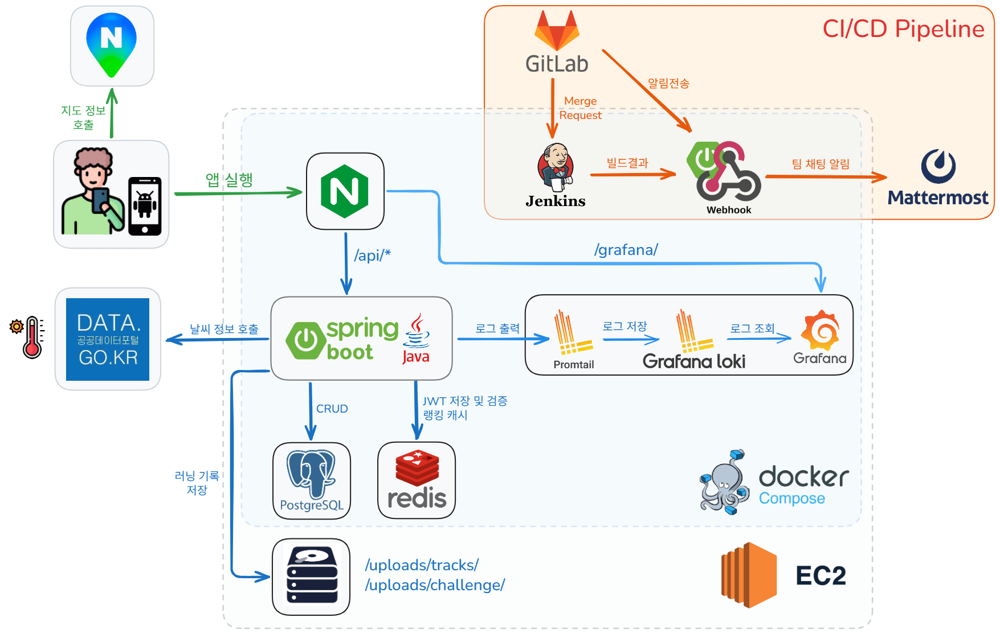

SSAFY 14기 자율 프로젝트 | S14P31A103

# DrawRun (드로우런)

> AI가 그린 그림을 달리기로 완성하고, 유사도를 판별하는 러닝 챌린지 서비스

---

## 📌 프로젝트 소개

AI가 생성한 그림 모양의 경로를 실제로 달리며 완성하고, 내 경로와 목표 경로의 유사도를 점수로 확인하는 **러닝 챌린지 서비스**입니다.

---

## 👥 팀원

| 이름 | 역할 |
|------|------|
| 박성문 | 팀장 FE INFRA |
| 강민규 | AI BE |
| 김종민 | BE |
| 김현아 | FE |
| 문관영 | BE FE |
| 신윤수 | BE INFRA |

### 강민규 담당
- 경로 유사도 알고리즘 설계 (리샘플링, Coverage·Adherence, 회전 탐색) — Spring Boot 채점 서비스로 구현
- OSM 도로 데이터 적재 스크립트 (고도 부착, 결측 보완, 스키마 멱등 적용)
- PostGIS 공간 쿼리 (도로 안전도 판정, 행정구역 역산)

---

## 📅 개발 기간

> 2026.04.06 ~ 2026.05.21

---

## 🖼️ 서비스 화면

<table>
  <tr>
    <th>메인 진입</th>
    <th>랭킹 조회</th>
    <th>코스 에디터</th>
  </tr>
  <tr>
    <td align="center"></td>
    <td align="center"></td>
    <td align="center"></td>
  </tr>
</table>

---

## 💡 핵심 기능

### 🏅 챌린지 러닝
- 매주 **EASY / HARD** 두 가지 챌린지 폴리곤 공개
- 같은 주차 EASY + HARD는 쌍으로 관리 (groupUUID)
- 달린 경로와 챌린지 폴리곤의 **유사도 점수** 계산 (0~100점)
- 주차별 랭킹 제공

### 📐 유사도 판별 알고리즘
- 두 경로를 각각 200개 점으로 등간격 리샘플링 (초기 500개에서 연산 시간 문제로 조정)
- GPS 위경도 → 평면 좌표 변환 (서울 위도 보정)
- 0°~350° 회전 탐색 후 ±12° 미세 조정으로 **최적 회전각** 탐색
- 정방향 + 역방향(경로 반전) 중 높은 점수 선택
- **Coverage** (내 경로가 폴리곤 안에 있는 정도) + **Adherence** (폴리곤이 내 경로 근처에 있는 정도) 평균

### 🗺️ 코스 생성 및 공유
- 달린 기록을 코스로 저장 및 공유
- **난이도 자동 계산**: 거리 / 오르막 경사도 / 누적 고도 상승 기준으로 자동 분류
  - BEGINNER → EASY → NORMAL → HARD
- 난이도·거리·지역·완주 여부 필터 + 무한 스크롤 검색
- 코스 북마크

### 📍 러닝 기록
- 실시간 GPS 추적
- 케이던스(보폭 빈도) 측정
- 완주 판정: 코스 경로와 80% 이상 공간 유사도
- OSM 도로 데이터 기반 안전 경로 판정
- 완주 시 경로 이미지 자동 생성

### 🌤️ 날씨
- 기상청 Open API 연동 (하루 8회 자동 갱신)
- 현재 위치 기반 날씨 조회
- Redis 캐시로 불필요한 API 호출 최소화

### 🏆 랭킹
- Redis Sorted Set 기반 코스별 / 챌린지별 랭킹
- 상위 5명 + 내 순위 + 내 앞 순위 제공

---

## ⚒️ 기술 스택

| 분류 | 기술 스택 |
|------|----------|
| **Frontend** |  |
| **Backend** |  |
| **Database** |  |
| **Infra** |  |
| **배포** |  |
| **협업 / 개발도구** |  |

상세 보기

### Frontend

| 항목 | 내용 |
|------|------|
| Framework | Flutter 3.41.7 / Dart |
| 상태관리 | Riverpod |
| 라우팅 | GoRouter |
| HTTP | Dio + JWT 인터셉터 |
| 지도 | flutter_naver_map |
| GPS / 센서 | geolocator, pedometer, sensors_plus |

### Backend

| 항목 | 내용 |
|------|------|
| Framework | Spring Boot 3.5.13 / Java 21 / Gradle |
| 인증 | Spring Security + JWT (jjwt 0.12.6) |
| ORM | Spring Data JPA + Hibernate Spatial |
| DB | PostgreSQL + PostGIS 16-3.4 |
| Cache | Redis |
| 공간 연산 | JTS (Java Topology Suite) |
| API 문서 | SpringDoc OpenAPI (Swagger) |

### Infrastructure

| 항목 | 내용 |
|------|------|
| 서버 | AWS EC2 (Ubuntu 24.04) |
| 컨테이너 | Docker Compose (9개 컨테이너) |
| 웹서버 | Nginx (리버스 프록시, SSL) |
| CI/CD | Jenkins |
| SSL | Certbot / Let's Encrypt |
| 모니터링 | Grafana + Loki + Promtail |
| 알림 | WebhookBridge → Mattermost |

### 외부 API

| 서비스 | 용도 |
|--------|------|
| 기상청 Open API | 러닝 중 현재 위치 날씨 조회 |
| 네이버 지도 API | 지도 렌더링 |
| Overpass API / OpenStreetMap | 도로·지형 데이터 |
| Open Elevation API | 고도 데이터 |

---

## 🌐 시스템 아키텍처

---

## 📋 포팅 매뉴얼

배포 환경 설정 전체 가이드는 [포팅 매뉴얼](https://www.notion.so/365f43795ffd80c7b9f0d2f1df9b5895#365f43795ffd8043be25db7c135769a1)을 참고하세요.
